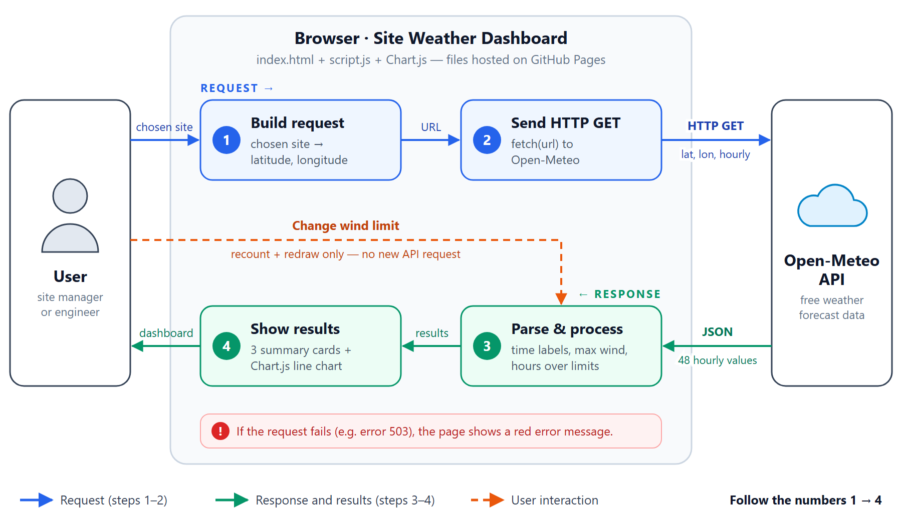

# Site Weather Dashboard

Live site: https://camifatechab.github.io/site-weather-dashboard/

## Summary

**Purpose.** Helps construction teams in Taiwan check whether the next 48 hours are suitable for crane lifts and concrete pours. Site managers can compare four Taiwanese cities and set their own crane wind limit.

**API and data.** Uses the free Open-Meteo Forecast API. When the page loads, or when the user picks a site (Taipei, Taichung, Kaohsiung or Penghu), JavaScript sends an HTTP GET request with that site's coordinates. The API returns JSON with 48 hourly values of temperature, rain probability and wind speed.

**Processing.** The frontend parses the JSON, formats timestamps into chart labels, finds the maximum wind speed, and counts the hours above a user-defined wind limit and the hours with at least a 50% chance of rain.

**Visualization.** Results appear as three summary cards and a Chart.js line chart with a dashed wind-limit line. Changing the limit recalculates instantly without a new request, and failed requests show an error message.

## System diagram (data flow)

The request travels along the top (steps 1–2) and the response comes back along the bottom (steps 3–4).

Weather data by [Open-Meteo.com](https://open-meteo.com/) (CC BY 4.0). Made by Cami.
